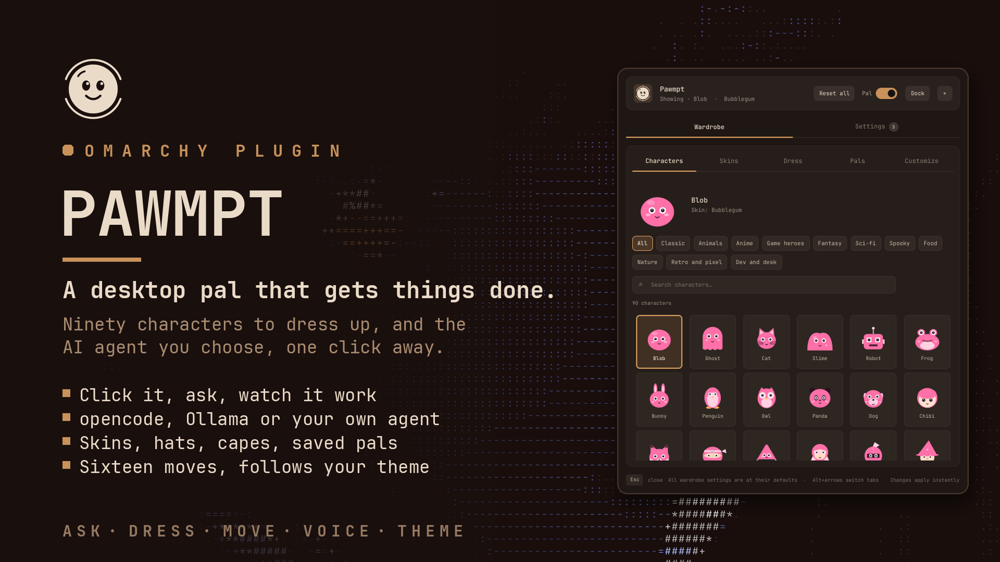
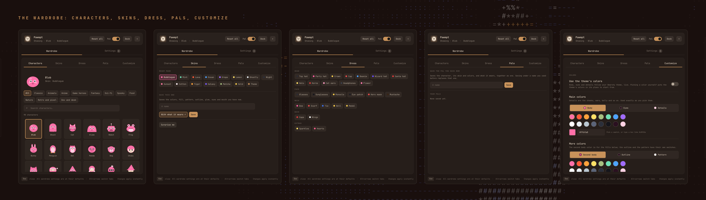
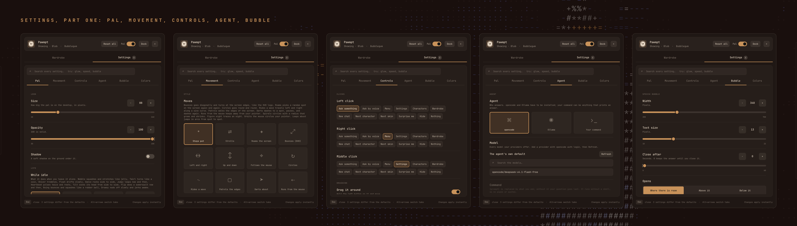
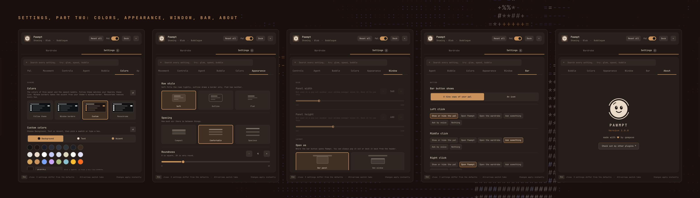

<p align="center">
  <picture>
    <source media="(prefers-color-scheme: light)" srcset="assets/logo-dark.png">
    
  </picture>
</p>

<h1 align="center">Pawmpt</h1>

<p align="center">A little pal on your <a href="https://omarchy.org">Omarchy</a> desktop that gets things done.</p>



Pawmpt is a small creature that lives on your desktop. Pick one of ninety characters or bring your own picture, dress it in skins, hats and capes, and click it to ask something. Your question goes to the coding agent you choose, opencode by default, with the model you pick. The pal shows what the agent does while it works and answers in a speech bubble. It can keep the conversation going, work in the folder of the window you are in, read what you selected, and run commands or edit files when you let it.

## Features

- **Ninety characters** in eleven categories (Classic, Animals, Anime, Game heroes, Fantasy, Sci-fi, Spooky, Food, Nature, Retro and pixel, Dev and desk), and any PNG, JPG, WebP, SVG or animated GIF of your own.
- **A wardrobe**: fifteen skins, your own colors, fills, patterns, outlines, glow, eyes and mouths, twenty-seven things to wear, and whole pals you save under a name.
- **Life**: sixteen idle moves, blinking, eyes that follow the mouse, falling asleep, and sixteen ways to move about the screen, from strolling and bouncing to following or running from the mouse.
- **An agent that works**: opencode with any model your providers offer, Ollama, or a command of your own, with live progress, tokens and cost, quick actions, follow-ups and voice through Hex.
- **Context**: the active window's folder and title, what you selected and what you copied, each one only when you turn it on.
- **Settings in the house style**: a bar panel or its own window, a search box over every page, color schemes from your theme or window border, and an About page.

### The agent

The bubble shows each step as it happens (› bash: git status, › read: src/main.rs), then the answer. **Reply** continues the chat, **Copy** and **Copy code** copy the answer, **Retry**, **Go on** and **Simpler** ask again, **New chat** starts over, and **Open in opencode** opens the same conversation in a terminal. **Stop** ends a long run. Quick actions (Explain, Summarize, Fix it, Translate, Reply, Shorter, and one of your own) work on what you selected.

### Ask by voice

[Hex](https://anoma.ly/hex) turns your voice into text on your own machine. Pawmpt does not listen itself: it tells Hex to start recording and, when you are done, to stop and hand over the words (`hex dictation start` and `hex dictation stop --print`), then asks the agent.

1. Install Hex and set it up once: `curl -fsSL https://anoma.ly/hex/files/install-linux.sh | sh`, then `hex model install`.
2. Settings › Agent › Voice › **Ask by voice** › Hex.
3. Click the mic in the question box, give a click **Ask by voice** (Controls or Bar), or bind `omarchy-shell io.github.qempexe.pawmpt voice` to a key. By default the transcription opens in the question box for review; `voice cancel` throws it away.

By default, Hex puts the transcription in the question box for you to review before sending. Turn on **Send when I stop speaking** to send it immediately. **Stop listening after** ends the recording and follows that same choice. **Hex command** is for when Hex is not on the PATH (`~/.local/bin/hex` is tried anyway). If Hex is not running, Pawmpt starts it and tries again.

Pawmpt ends only the recording it started:

- **Cancel** (`voice cancel`) drops it. Hex 3.3 and later have no cancel, as every dictation there finishes, so Pawmpt stops it with `hex dictation stop --print`, which never pastes, and throws the words away. Hex keeps them in its History as Printed. If Hex can't stop it, Pawmpt says so, and how to stop it yourself.
- **Turning voice off, or hiding Pawmpt,** drops it too, so it never keeps recording where you can't see it. A shell reload drops it a moment later.
- **A dictation of your own already recording** is left alone: Pawmpt asks you to finish it first instead of taking your words.
- **Hex's own shortcut** also finishes a recording Pawmpt started, and Hex then pastes the words where you are, as usual. Pawmpt notices within a few seconds and says so, and it does the same when Hex stops.

### The wardrobe



### Settings





## Installation

```bash
omarchy plugin add https://github.com/qempexe/omarchy-pawmpt.git --enable
omarchy restart shell
```

The bar button goes to the right of the bar; move it from the bar settings, or with `omarchy bar move io.github.qempexe.pawmpt --section left` (or `center`, `right`).

For the agent, install [opencode](https://opencode.ai) and connect a provider with `opencode auth login`, or install [Ollama](https://ollama.com). Asking by voice needs [Hex](https://anoma.ly/hex) (see [Ask by voice](#ask-by-voice)). Everything else comes with Omarchy: `hyprctl`, `wl-clipboard` and `xdg-open`.

## Usage

| On the pal | Does |
| --- | --- |
| Left click | ask something; Enter sends, Esc closes |
| Drag | move it; drop it at a screen's side edge to send it to the next screen |
| Right click | the menu |
| Middle click | the settings |

What each click does is yours to change in **Controls**.

| On the bar button | Does |
| --- | --- |
| Left click | show or hide the pal |
| Middle click | ask something |
| Right click | open Pawmpt |

### From a terminal

```bash
omarchy-shell io.github.qempexe.pawmpt toggle             # also: show, hide, ask, settings, panel, wardrobe
omarchy-shell io.github.qempexe.pawmpt send "summarise my notes"
omarchy-shell io.github.qempexe.pawmpt quick explain      # a quick action on what you selected
omarchy-shell io.github.qempexe.pawmpt voice toggle       # also: start, stop, cancel
omarchy-shell io.github.qempexe.pawmpt retry              # also: newChat
omarchy-shell io.github.qempexe.pawmpt character cat      # also: nextCharacter, nextSkin, surprise
omarchy-shell io.github.qempexe.pawmpt skin Mint
omarchy-shell io.github.qempexe.pawmpt wear tophat        # also: undress
omarchy-shell io.github.qempexe.pawmpt pal "My pal"       # a pal you saved
omarchy-shell io.github.qempexe.pawmpt status
```

## Configuration

Everything applies at once and is saved in `~/.local/state/omarchy-pawmpt/`. Each changed row gets a **↺** to put it back, and **Reset all** in the header puts back everything.

| Page | Setting | Default | |
| --- | --- | --- | --- |
| Pal | Size, Opacity | 88 px, 100% | |
| | Shadow, Blink, Eyes follow the mouse | off, on, on | |
| | While idle | Breathe | or Bob, Sway, Hop, Still, Wobble, Twirl, Shiver, Float, Dance, Jumpy, Heartbeat, Tilt, Flip, Boing, Drowsy |
| | Fall asleep after | never | up to 120 minutes |
| | Surprise me | Never | a new look at every start, every hour or every day |
| Movement | Moves | Stays put | or strolls, roams, bounces, follows or runs from the mouse, circles, patrols the edges and more |
| | Speed, Keep away from the edges | 60 px/s, 0 px | |
| | Rest now and then, Face where it goes | on, on | |
| | Stop when the mouse is on it, Stop while the agent works | on, on | |
| Controls | Left, right and middle click | Ask, Menu, Settings | |
| | Drag it around, Remember where it was | on, on | |
| | Drop it at the side to change screen | on | |
| Agent | Agent | opencode | or Ollama, Claude Code, Codex, or your own command |
| | Model | the agent's own default | searchable list of every model your providers offer |
| | Agent mode | Build | or Plan, which only reads and suggests |
| | Thinking effort | Model default | Low, Medium, High or Max |
| | Let it act | off | automatically approves opencode actions; off, Pawmpt shows Allow once and Deny buttons |
| | Look things up online | off | with Let it act off, lets it search the web and open pages |
| | Answer style, Answer in | As it likes, any language | Short, Detailed, Step by step or Simple |
| | Remember the conversation | on | a new chat after 45 minutes of quiet |
| | Tell it about the active window | on | |
| | Tell it what I have selected, what I copied | off, off | at most 4000 characters |
| | Work in | The active window's folder | or Home, or a folder |
| | Quick actions | on | and one of your own |
| | Copy the answer, Notify me | off, off | |
| | Give up after, Try again when it fails | 300 s, never | |
| | Ask by voice | Off | Hex, with review before sending by default |
| Bubble | Width, Text size | 340 px, 13 | |
| | Close after, Opens | never, where there is room | |
| | Show what it is doing, tokens and folder, follow-up buttons | on, on, on | |
| Colors | Colors | Follow theme | Follow theme, Window borders, Custom or Monochrome |
| | Custom colors | | background, text and accent, used exactly as you pick them |
| Appearance | Row style, Spacing, Roundness, Text size | Soft, Comfortable, 4, 100% | |
| Window | Panel width, height | 560 × 680 | |
| | Open as | Bar panel | or Own window |
| | Window outline, tint, opacity | off, 0, 97 | the outline in your window border's colors |
| Bar | Bar button shows | A tiny copy of your pal | or An icon |
| | Left, middle and right click | Show or hide, Ask, Open Pawmpt | |

**About**, the last page, has the logo, the version and a link to more plugins.

Hyprland tiles new windows. To float the popped-out panel, add to `~/.config/hypr/hyprland.lua`:

```lua
o.window({ class = "^org\\.quickshell$", title = "^Pawmpt$" }, { tag = "+pawmpt-window" })
o.window({ tag = "pawmpt-window" }, { float = true })
o.window({ tag = "pawmpt-window" }, { center = true })
o.window({ tag = "pawmpt-window" }, { size = { 560, 680 } })
```

## Troubleshooting

- **The pal doesn't show after installing.** Restart the shell once with `omarchy restart shell`.
- **The bar button does nothing.** It looks for Pawmpt's service through the bar, and through Pawmpt itself when the bar is a replacement that can't hand it over. If it still does nothing, restart the shell.
- **It keeps thinking.** Check that `opencode run "hi"` answers in a terminal.
- **It pauses before an action.** With **Let it act** off, OpenCode asks Pawmpt to show Allow once and Deny buttons. Turn it on to auto-approve actions.
- **It won't search the web.** With Let it act off that needs **Look things up online** too.
- **Unrecognized flag.** opencode versions differ; Pawmpt leaves out a flag your opencode doesn't know and asks again.
- **No models in the list.** Connect a provider with `opencode auth login`, then press **Refresh**.
- **Where things live.**

  | Path | Contents |
  | --- | --- |
  | `~/.local/state/omarchy-pawmpt/` | your settings, skins and pals |
  | `~/.config/pawmpt/characters/` | the characters you added, one folder per category |

- **Network.** Pawmpt itself goes nowhere. Your question goes to the agent you picked, which talks to its own provider.
- **What it reads.** The active window's title and folder, and what you selected or copied, are only read when you ask, only when that setting is on, and at most 64 KB of it.
- **What Let it act off does.** Pawmpt sets OpenCode's permission policy to ask before actions and shows the request in the approval card. Project configuration, plugins, MCP servers, and policy changes can affect permissions; this is not an operating system sandbox. The model provider still receives the prompt and any context you enabled.
- **Project trust.** OpenCode loads project configuration, plugins and MCP servers from the work folder. Those components run with your user account's access. Use **Work in** with a folder you trust, and review project extensions before running an agent there. Hex and custom agents also run as your user; configure them only with executables you trust. **Let it act** is off by default; turning it on auto-approves OpenCode actions.
- **What other users can see.** Your question, the context and the answers never go in a command's arguments, which anyone on the computer can list: the agent gets the question on stdin, copying goes to `wl-copy` on stdin, and a notification only says that an answer is ready. The one exception is putting `{prompt}` in your own command.
- **Approval buttons for a custom agent.** Turn on **Approval bridge** only when your command is an adapter for an agent that can pause for permission. Pawmpt uses a JSON Lines request/reply protocol described in [`tools/AGENT_APPROVAL_PROTOCOL.md`](tools/AGENT_APPROVAL_PROTOCOL.md). The adapter must translate Allow or Deny to that agent's own permission API; ordinary `claude -p` or `codex exec` commands do not speak this protocol by themselves.
- **Approval buttons for Claude Code and Codex.** Select the named agent in Settings. Pawmpt connects Claude Code's permission-prompt MCP tool or Codex's app-server request channel to the same Allow once / Deny card. Their own settings can still pre-allow or deny specific actions before they reach Pawmpt.
- **Codex desktop apps.** If Codex reports that a requested Strata, Brave, Firefox, Chromium, Foot or Glances launch failed because its sandbox cannot reach the display, Pawmpt offers an Allow once button to start only that app directly in your Omarchy desktop session. It does not retry the Codex turn outside its sandbox.

## Contributing

Bug reports and ideas are welcome as [issues](https://github.com/qempexe/omarchy-pawmpt/issues). [CONTRIBUTING.md](CONTRIBUTING.md) shows how to add a character, a skin or something to wear, and how to run the checks. Everyone taking part is expected to follow the [code of conduct](CODE_OF_CONDUCT.md). What changed in each version is in the [changelog](CHANGELOG.md).

### Source layout

```
qml/
├── Service.qml        settings, characters, skins, the agent, voice, ipc
├── Pal.qml            the pal on the desktop: moving, the prompt, the bubble, the menu
├── BarWidget.qml      the bar button and the panel by the bar
├── Panel.qml          the panel that hangs off the bar
├── PopoutWindow.qml   the panel as a window of its own
├── UiState.qml        colors, spacing and the open page
├── views/             PalView, SettingsView, CharactersPage, SkinsPage, DressPage, PalsPage, AboutPage
├── controls/          Critter (one pal, drawn or a picture), SettingRow, TileArt, Btn, Chip, Field, Sw, Txt, PasteInput
└── js/
    ├── Schema.js      every setting: its page, options and default
    ├── Skins.js       the characters, the skins and the things to wear
    ├── Draw.js        how every character and item is drawn
    ├── Prompt.js      what is sent to the agent
    ├── Voice.js       asking by voice through Hex
    ├── Theme.js, Glow.js, Registry.js
assets/                the logo, light and dark
tools/                 check.js (every character at every size), gen-manifest.js, preview.js
tests/                 node tests/test_manifest.js, test_prompt.js, test_voice.js, test_glow.js
```

### Upgrading and uninstalling

```bash
omarchy plugin update io.github.qempexe.pawmpt
omarchy restart shell
```

```bash
omarchy plugin remove io.github.qempexe.pawmpt
omarchy restart shell
rm -rf ~/.local/state/omarchy-pawmpt ~/.config/pawmpt   # settings, pals and your characters, if you want them gone
```

## License and credits

[MIT](LICENSE).

- Inspired by **[goop](https://github.com/nightdevil00/mihai.goop)**, the idea of a creature on the desktop that takes requests.
- Thanks to the **Omarchy** project for the shell and its plugin system, to **Hyprland**, and to **Quickshell** and **Qt** for the toolkit.
- Thanks to **opencode**, **Ollama** and **Hex**, which do the talking.
- Thanks to everyone who tests it and reports issues.

Pawmpt is an independent community plugin. It is not affiliated with or endorsed by Omarchy, opencode, Ollama or Hex. The characters are drawn from scratch and only nod at the kinds of heroes they are named after.
